# Video Fundamentals, Encoding, and Delivery

Encoding is not just the last step in an export dialog. It is a technical chain that starts when source media is read and runs through decoding, color conversion, scaling, compositing, frame-rate handling, audio processing, and final muxing. A misinterpretation at any point can cause color shifts, banding, combing, audio drift, or generation loss.

This page draws mainly on the video fundamentals, defect identification, and encoding material in the [public VCB-Studio guides](https://guides.vcb-s.com/), reorganized around a MAD·AMV production workflow. The VCB-Studio guides are written mainly for BDRip production; this page focuses on how to preserve the original information once source media enters an editing application, and how to deliver a finished work reliably. For where source media comes from, intake records, and project archiving, see [Source Media and Project Management](/en/tools/footage).

::: warning Check contest or platform requirements first
Contests may specify resolution, frame rate, container, codec, bitrate, file size, and delivery method. A technically “higher” specification does not necessarily comply with the rules. Before submitting, follow the organizer's text for the current edition and see the site's [Contest and Submission Guidelines](/en/mad/contest-rules).
:::

## 1. Getting the Basic Terms Straight

### Files, Containers, and Tracks

A typical video file has three layers:

| Layer | Meaning | Examples |
| --- | --- | --- |
| File | The object stored on disk | `work.mkv`, `master.mov` |
| Container | A format that holds several media streams plus metadata | Matroska/MKV, MP4, MOV |
| Track or stream | An independent piece of media inside the container | Video, audio, subtitles, chapters, attachments |

A file extension usually tells you only the container, not the video codec. Two `.mp4` files can contain AVC, HEVC, or AV1 video, and different audio codecs as well.

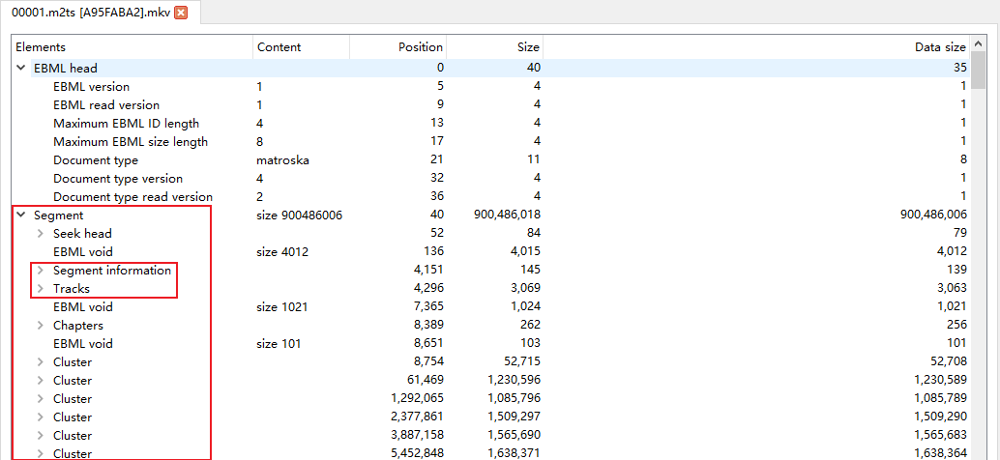

*Figure: Basic structure of a Matroska file. Source: VCB-Studio, “Understanding Video from Scratch.”*

### Codecs, Encoders, and Decoders

- A **codec** (coding standard) defines how compressed data is organized, for example AVC/H.264, HEVC/H.265, or AV1.
- An **encoder** is software or hardware that implements a coding standard. x264 is an AVC encoder; x265 is an HEVC encoder.
- A **decoder** turns the compressed bitstream back into images and sound that can be displayed or processed further.
- **A standard is not the same as an encoder.** `H.264` and `x264`, or `H.265` and `x265`, are names at different levels.

### Demuxing, Muxing, Remuxing, and Transcoding

| Operation | Recompresses? | Description |
| --- | --- | --- |
| Demux | No | Extracts video, audio, subtitle, and other tracks from a container |
| Mux | No | Packs independent tracks and metadata into a container |
| Remux | Usually no | Keeps the track contents and changes only the container or track layout |
| Transcode | Yes | Decodes and encodes again with different settings |
| Re-encode | Yes | Any recompression produces a new generation, even with the same coding standard |

Remuxing cannot repair quality problems already present in the bitstream. Conversely, if the only problem is that an editor does not support the container, there is no need for a lossy transcode first.

### Lossless, Lossy, and Generation Loss

- **Lossless coding** lets you recover data identical sample for sample. It does not mean the file has never been processed.
- **Lossy coding** deliberately discards some information to achieve higher compression.
- **Visually lossless** means differences are hard to see under particular viewing conditions; it is not mathematically lossless.
- **Generation loss** is the error that accumulates each time lossy media is decoded, processed, and encoded again.

In MAD·AMV production, keep processing of the original source to what is necessary, and generate each platform's upload from a high-quality master. Avoid re-editing from a copy downloaded from a platform.

## 2. Inspect Source Media Instead of Guessing

### Recommended Tools

- [MediaInfo](https://mediaarea.net/MediaInfo): a quick view of the container, tracks, and encoding parameters;
- [ffprobe](https://ffmpeg.org/ffprobe.html): reads streams, timestamps, frame rate, and color metadata;
- A player or preview tool that can step frame by frame, switch field order, and show frame numbers;
- The clip properties, sequence settings, and color management panels of your editing software.

A basic inspection command:

```bash
ffprobe -v error -show_format -show_streams -of json input.mkv
```

To check only the most useful fields of the first video stream:

```bash
ffprobe -v error -select_streams v:0 \
  -show_entries stream=codec_name,profile,width,height,pix_fmt,field_order,r_frame_rate,avg_frame_rate,time_base,color_range,color_space,color_transfer,color_primaries \
  -of default=noprint_wrappers=1 input.mkv
```

::: tip Commands only read what is already recorded
Metadata can be missing or wrong. Always check the results against the source's published specifications, the actual picture, the frame sequence, and how your software interprets the file.
:::

### Video Source Checklist

| Item | What to confirm | What goes wrong if misread |
| --- | --- | --- |
| Container and tracks | Video, audio, subtitles, chapters, attachments | Missing tracks, wrong default track, missing subtitle fonts |
| Codec and profile | Codec, profile, level/tier | Cannot decode, hardware compatibility problems |
| Frame size | Coded size, display size, cropping, rotation | Stretching, black bars, wrong orientation |
| Pixel aspect ratio | SAR, DAR | Characters and graphics in the wrong proportions |
| Pixel format | RGB/YUV, 4:4:4/4:2:2/4:2:0, bit depth, alpha | Color fringing, banding in gradients, bad transparent edges |
| Frame rate | Exact fraction, CFR/VFR, time base | Duplicated or dropped frames, audio drift |
| Scan type | Progressive, interlaced, field order, telecine | Combing, judder, repeated fields |
| Color metadata | Primaries, transfer, matrix, range | Color casts, washed-out or crushed blacks, clipped highlights |
| HDR information | PQ/HLG, static or dynamic metadata | Picture too dark or too bright, wrong colors |
| Audio | Codec, sample rate, bit depth, channel layout, delay | Pitch shift, swapped channels, loss of sync |

## 3. Frame Size, Pixels, and Sampling

### Resolution, Display Aspect Ratio, and Pixel Aspect Ratio

- **Resolution** is the number of samples across and down the frame, for example `1920 × 1080`.
- **SAR (Sample Aspect Ratio)** describes the shape of a single sample. Square pixels are usually `1:1`.
- **DAR (Display Aspect Ratio)** is the final displayed shape of the frame.
- Roughly: `DAR = frame width ÷ height × SAR`.

Older broadcast standards, DVDs, and broadcast sources may use non-square pixels. Scaling directly from a coded size such as `720 × 480` can produce the wrong proportions.

### RGB, YUV, and YCbCr

RGB stores red, green, and blue components and suits display, graphics, and compositing. Video coding usually uses digital YCbCr: Y′ carries a luma component that has passed through a transfer function, and Cb and Cr carry color-difference signals. Software interfaces often call YCbCr “YUV,” but the two are not strictly the same.

Human vision is generally more sensitive to detail in brightness than in color, so video can sample color at lower resolution to save data.

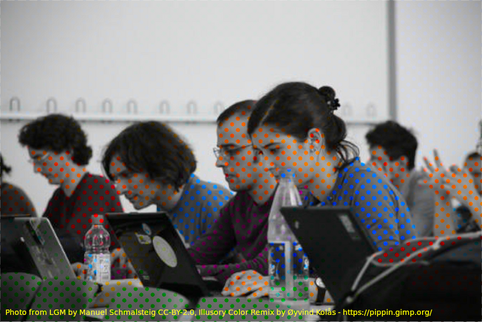

*Figure: A color assimilation example showing how differently we perceive luma and chroma. Source: VCB-Studio, “Understanding Video from Scratch.”*

### Chroma Subsampling

`4:4:4`, `4:2:2`, and `4:2:0` describe how many luma and chroma samples are taken within a block of pixels. They are not “quality percentages.”

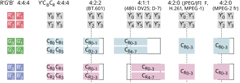

*Figure: Common chroma subsampling patterns. Source: VCB-Studio, “Understanding Video from Scratch.”*

| Format | Characteristics | Typical use in MAD·AMV |
| --- | --- | --- |
| 4:4:4 | Every luma sample has a matching chroma sample | Graphics, text, keying, compositing intermediates |
| 4:2:2 | Chroma halved horizontally | Professional capture, production intermediates |
| 4:2:0 | Chroma halved both horizontally and vertically | BD, web video, and most delivery files |

4:2:0 also involves **chroma location**. Different standards place chroma samples at different positions relative to the pixel grid; reading it wrongly can shift color by about half a pixel.


*Figure: Chroma subsampling and sample locations. Source: VCB-Studio, “Understanding Video from Scratch.”*

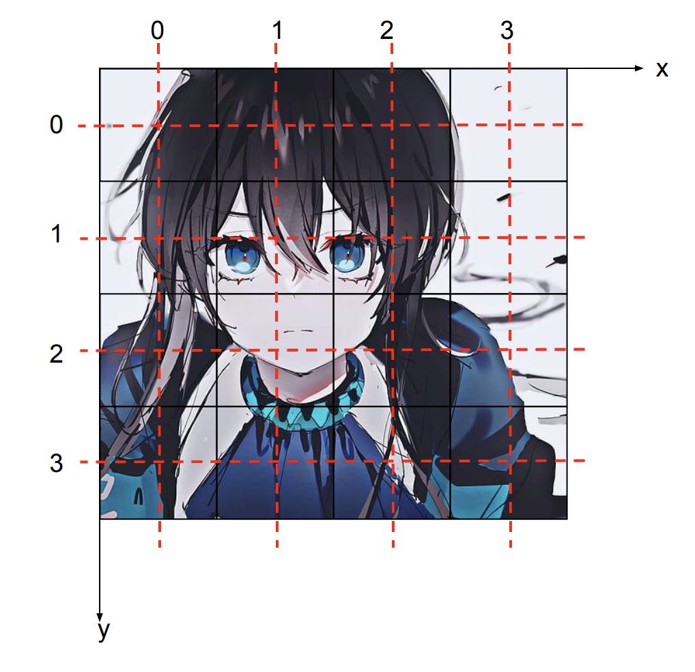

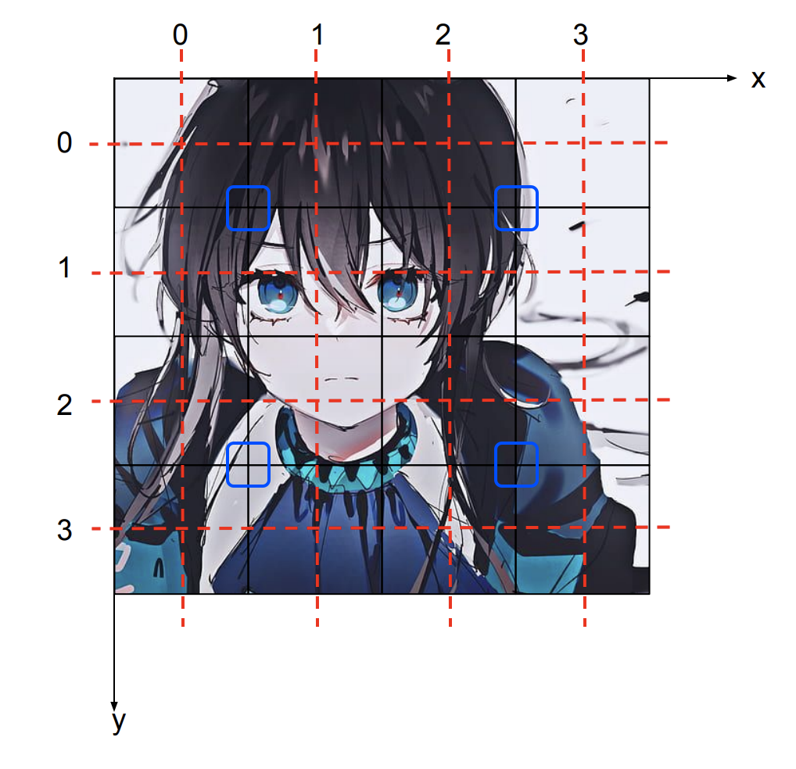

*Figure: Luma and chroma sample grids. Source: VCB-Studio, “Understanding Video from Scratch.”*

### Bit Depth, Quantization, and Dither

Bit depth determines how many discrete levels each component can represent:

- 8-bit: up to `2⁸ = 256` code values per component;
- 10-bit: up to `2¹⁰ = 1024` code values per component;
- 12-bit: up to `2¹² = 4096` code values per component.

A higher bit depth cannot bring back detail that has already been lost, but it reduces rounding errors during grading, gradients, blurs, glows, and repeated compositing. When converting from a higher to a lower bit depth, **dither** turns regular quantization steps into faint, less visible noise.

Common pixel format names:

| Name | Meaning |
| --- | --- |
| `yuv420p` | 8-bit planar YUV 4:2:0 |
| `yuv420p10le` | 10-bit, little-endian, planar YUV 4:2:0 |
| `yuv422p10le` | 10-bit planar YUV 4:2:2 |
| `yuv444p10le` | 10-bit planar YUV 4:4:4 |
| `gbrp` / `gbrp10le` | Planar RGB, 8-bit / 10-bit |
| `rgba` | Packed RGB with alpha |

### Alpha Channels

Alpha stores transparency. In compositing, you must distinguish between:

- **Straight (unmatted) alpha**: RGB holds color that has not been multiplied by alpha;
- **Premultiplied (matted) alpha**: RGB has already been multiplied by alpha.

Interpreting alpha the wrong way produces dark or light fringes or color contamination at transparent edges. Delivery files in H.264/HEVC are generally not meant to carry transparency; for transparent compositing, use an intermediate format or image sequence that explicitly supports alpha.

## 4. Color Management

### Human Vision, CIE, and Color Gamut

Color primaries are not a “number of colors.” They are three primary coordinates plus a white point that together define the gamut a signal can encode. The figure below shows the relative response of the three types of cone cells in the human eye to different wavelengths.

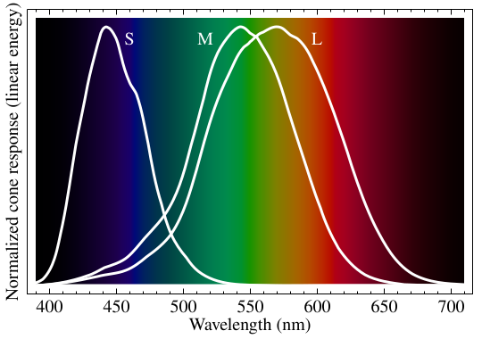

*Figure: Normalized spectral response of human cones. Source: VCB-Studio, “Understanding Video from Scratch.”*

The CIE xy chromaticity diagram projects visible colors onto a two-dimensional plane. A standard's RGB primaries form a triangle on the diagram; the area inside is the range of colors those primaries can represent.

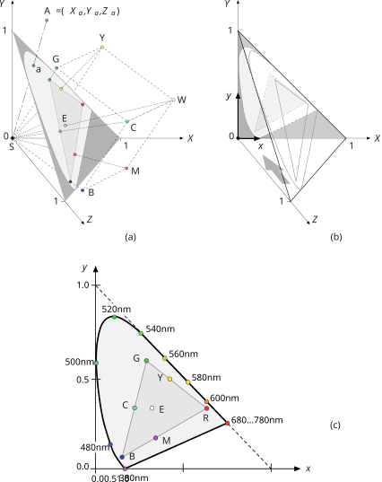

*Figure: CIE xy chromaticity diagram. Source: VCB-Studio, “Understanding Video from Scratch.”*

### Four Properties That Determine Video Color

| Property | What it determines | Typical symptom when mislabeled |
| --- | --- | --- |
| Color primaries | The RGB primary coordinates and white point, i.e. the gamut | Wrong hue and saturation in saturated colors |
| Transfer characteristics | The relationship between linear light and code values | Wrong midtones, contrast, and HDR brightness |
| Matrix coefficients | The conversion between RGB and Y′CbCr | An overall color cast, with skin tones and saturated colors clearly off |
| Color range | Which code values count as the valid range | Washed-out or crushed blacks, blown highlights, clipped detail |

These four properties are independent. Writing just “Rec.709” without saying whether it refers to the primaries, the transfer, or the matrix is not enough, and you should not override metadata based on resolution alone.

### Rec.601, Rec.709, and Rec.2020


*Figure: Rec.601 chromaticity diagram.*

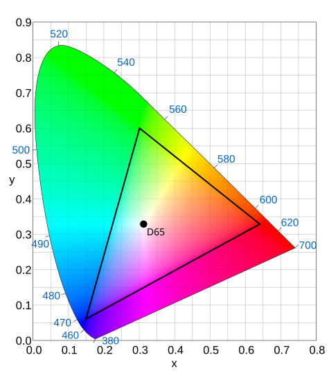

*Figure: Rec.709 chromaticity diagram.*

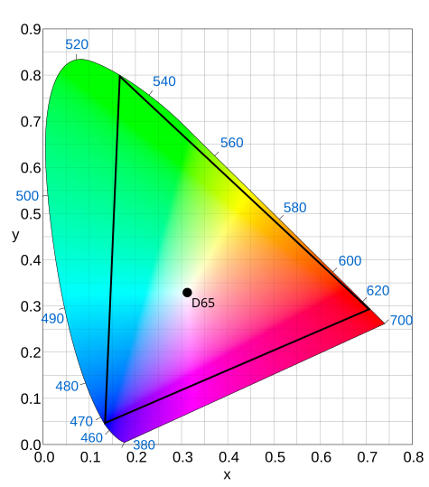

*Figure: Rec.2020 chromaticity diagram. All three figures: VCB-Studio, “Understanding Video from Scratch.”*

- **Rec.601** is common in SD digital video, but NTSC and PAL systems still need to be distinguished;
- **Rec.709** is the most common combination for HD SDR production and delivery;
- **Rec.2020** defines wider-gamut primaries for UHD; actual content does not necessarily reach the edges;
- **sRGB** uses the same primaries and D65 white point as Rec.709, but its transfer function and intended use are not simply identical;
- **Display P3 / DCI-P3** is not another name for Rec.2020 either.

### Transfer, Gamma, PQ, and HLG

A transfer function maps linear light to nonlinear code values suited to recording and transmission. For traditional SDR this is often loosely called gamma. Common HDR transfers are:

- **PQ / ST 2084**: based on absolute display luminance;
- **HLG**: a relative system designed for broadcast compatibility.

Converting HDR to SDR is not just a matter of changing a label; it requires gamut mapping and tone mapping. Likewise, tagging an SDR file as HDR does not make it real HDR.

### Full Range and Limited Range

For typical Y′CbCr:

| Bit depth | Limited Y′ | Limited Cb/Cr | Full |
| --- | --- | --- | --- |
| 8-bit | 16–235 | 16–240 | 0–255 |
| 10-bit | 64–940 | 64–960 | 0–1023 |

Limited-range signals may still carry headroom and footroom beyond the nominal range. Do not clip at every step without reason, and do not mistake changing a tag for converting the values.

Keep three operations clearly apart:

1. **Changing the tag**: only changes how players interpret the existing values;
2. **Converting the range**: actually remaps pixel values;
3. **Clipping the range**: truncates out-of-range values to the limit.

One wrong conversion can make the picture look washed out; repeated conversions or wrong clipping can permanently lose shadow and highlight detail.

### Color Management in a Project

A MAD·AMV project should fix and record:

- The working color space;
- Timeline bit depth or floating-point precision;
- Input transforms for each source;
- The monitor and preview chain;
- The output color space and color metadata;
- Whether OCIO, ACES, or the application's own color management is used;
- How screenshots, graphics, and PNG assets are interpreted (sRGB/ICC).

“It looks the same” only means something under the same viewing conditions and the same color management chain. System players, browsers, editing software, and platform transcodes may all manage color differently.

## 5. Frames, Fields, Timestamps, and Motion Cadence

### Frame Rate Is Not a Rounded Integer

Keep common frame rates as exact fractions:

| Common shorthand | Exact value |
| --- | --- |
| 23.976 | `24000/1001` |
| 24 | `24/1` |
| 29.97 | `30000/1001` |
| 30 | `30/1` |
| 59.94 | `60000/1001` |
| 60 | `60/1` |

Over a long duration, `23.976` versus `24` and `29.97` versus `30` add up to a visible difference in length. Check audio sync, subtitle timing, and contest time limits against the real timestamps.

### CFR, VFR, Time Base, and Timestamps

- **CFR (constant frame rate)**: every frame is displayed for the same interval;
- **VFR (variable frame rate)**: display intervals can differ from frame to frame;
- **Time base**: the smallest unit in which timestamps are counted;
- **PTS**: when a frame should be presented;
- **DTS**: when a frame should enter the decoder.

Because B-frames reference later pictures, display order and decode order can differ, so PTS and DTS do not always match.

Neither `r_frame_rate`, `avg_frame_rate`, nor “total frames ÷ duration” alone proves that footage is CFR. Before phone recordings, screen captures, and downloaded clips go into your editor, check their actual timestamps and run a sync test.

### Progressive and Interlaced

- **Progressive**: each frame holds a complete picture from one moment;
- **Interlaced**: each frame is made of two fields captured at different moments;
- **TFF (top field first)**: the top field is displayed first;
- **BFF (bottom field first)**: the bottom field is displayed first.

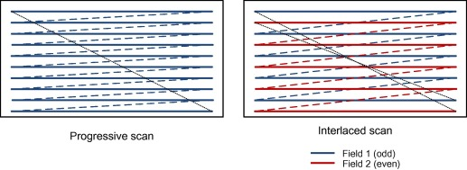

*Figure: Progressive and interlaced scanning. Source: VCB-Studio, “Understanding Video from Scratch.”*

Scaling, rotating, or sharpening interlaced footage as if it were progressive bakes the field structure into defects that are much harder to fix. The usual order is to identify the field structure first, apply the correct field matching, deinterlacing, or inverse telecine, and only then move into a progressive editing workflow.

### Telecine, Field Matching, and IVTC

Film and TV animation is often produced at close to 24 fps and then converted to an interlaced system of about 29.97 fps using 3:2 pulldown or similar methods. **IVTC (inverse telecine)** tries to recover the original progressive frame sequence; it is not the same as ordinary deinterlacing.

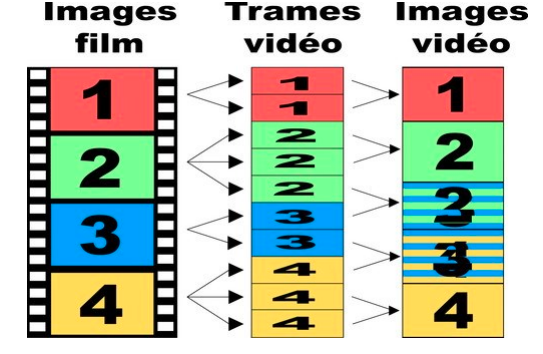

*Figure: How fields are distributed in 3:2 pulldown. Source: VCB-Studio, “Basic 30 fps Processing.”*

Real anime sources may mix:

- 24p: progressive content at about 24 fps;
- 30p: progressive content at about 30 fps;
- 30i: about 59.94 fields per second, each from a different moment;
- 24t: 24p converted by regular telecine;
- 24d: duplicate frames inserted into a roughly 30 fps sequence;
- Mixed frame rates, repeated fields, bad fields, and subtitles added in post.

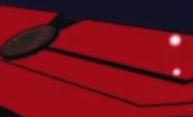

*Figure: Field phase shift. Source: VCB-Studio, “Basic 30 fps Processing.”*

Do not mechanically “remove duplicate frames” from an entire clip or interpolate everything to 60 fps. Confirm the real motion cadence section by section before processing; cuts, pans, subtitles, and effects layers may each use a different cadence.

### Animation Timing and Video Frame Rate

Animating “on ones, twos, or threes” describes how many frames each drawing is held for; it is not the container frame rate. A 23.976 fps file can show the same drawing for several consecutive frames. Those repeats may be the intended rhythm of the animation, not redundant frames to delete.

Interpolation creates in-between images that do not exist in the original. Occlusion, fast cuts, flashes, particles, text, and deforming shots are especially prone to warping. It is not a lossless frame-rate conversion.

## 6. How Video Compression Works

### Intra-Frame Compression: Transform, Quantization, and Entropy Coding

Encoders usually divide the picture into blocks, transform the spatial signal into the frequency domain, and then quantize the coefficients. Smooth changes sit in the low frequencies; fine lines, texture, and noise carry more high-frequency information.

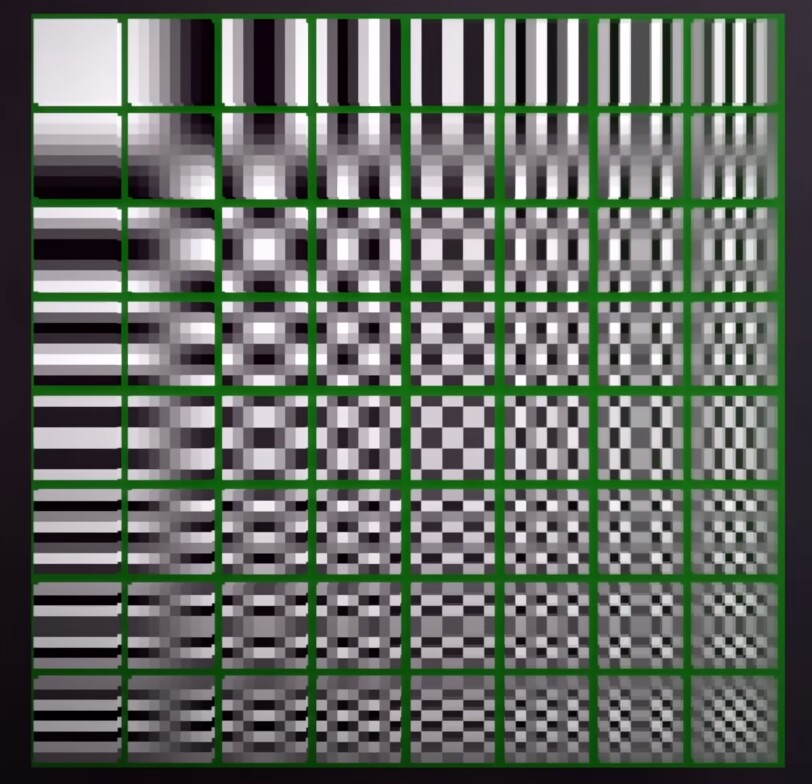

*Figure: 8 × 8 DCT basis functions. Source: VCB-Studio, “Video Encoder Fundamentals.”*

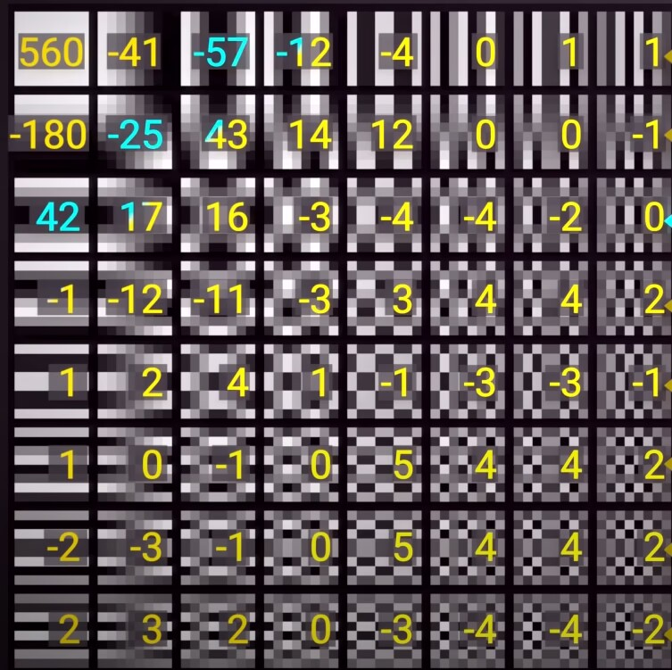

*Figure: DCT coefficients of an image block after transformation. Source: VCB-Studio, “Video Encoder Fundamentals.”*

**Quantization** reduces coefficient precision and is the main point of information loss in typical lossy coding. The stronger the quantization, the more high-frequency detail disappears. The remaining data is then compressed losslessly with entropy coding.

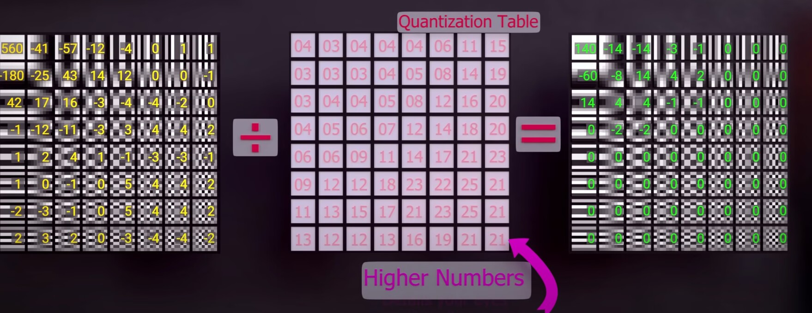

*Figure: A quantization table. Source: VCB-Studio, “Video Encoder Fundamentals.”*

### Inter-Frame Compression: Prediction and Motion Compensation

Consecutive video frames are usually very similar. Instead of storing a full picture for every frame, the encoder searches reference frames for similar regions and records motion vectors and the prediction residual.

| Frame type | Basic role |
| --- | --- |
| I-frame | Coded using only information within the frame; a basis for random access |
| P-frame | Predicted from earlier reference frames |
| B-frame | Can be predicted from both earlier and later reference frames |

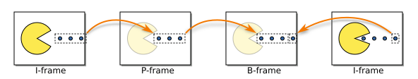

*Figure: Basic reference relationships between I-, P-, and B-frames. Source: VCB-Studio, “Understanding Video from Scratch.”*

### GOP, Keyframes, and Random Access

A **GOP (group of pictures)** is a set of coded pictures that reference one another. The keyframe interval affects:

- Seeking and cutting precision;
- Recovery after a scene change;
- Compression efficiency;
- Streaming segmentation and platform transcoding;
- How far errors propagate.

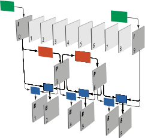

*Figure: GOP structure and inter-frame references. Source: VCB-Studio, “Understanding Video from Scratch.”*

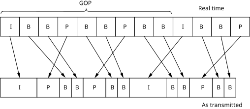

*Figure: Display order versus transmission/decode order. Source: VCB-Studio, “Understanding Video from Scratch.”*

A longer keyframe interval is not automatically better, and there is no single number to apply everywhere. Short films, contest openings, files that need precise cutting, and streaming platforms each have different random-access needs.

### Why Block Structures Keep Evolving

Different coding standards allow different block and prediction structures. More flexible partitioning describes flat areas, lines, and motion boundaries more accurately, but costs more computation to encode.

| MPEG-2 example | AVC/H.264 example | HEVC/H.265 example |
| --- | --- | --- |
| 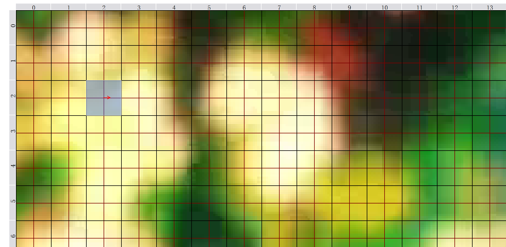 | 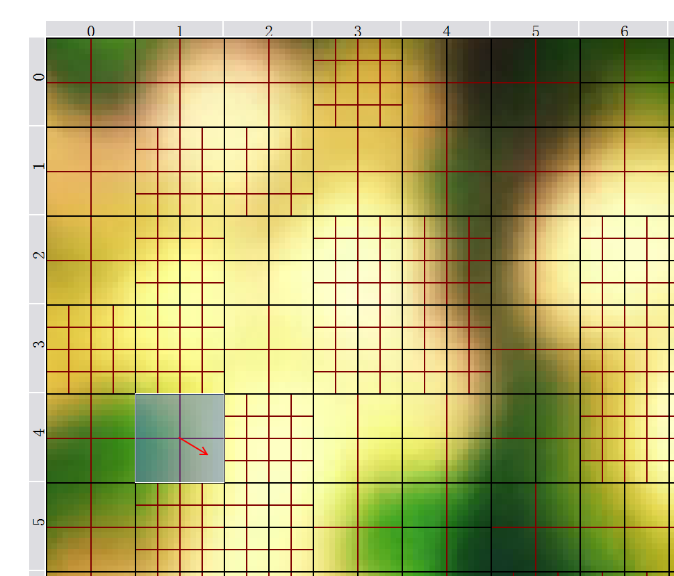 | 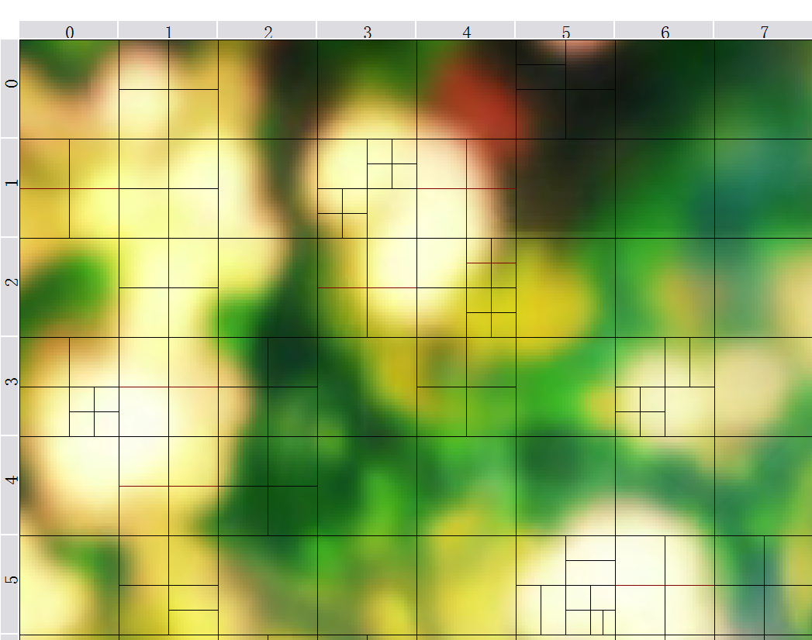 |

*Figure: Block partitioning in different coding standards. Source: VCB-Studio, “Video Encoder Fundamentals.”*

### Profile, Level, and Tier

- **Profile** specifies which coding tools and pixel formats may be used;
- **Level** caps complexity such as resolution, frame rate, bitrate, and buffer size;
- **Tier**, found in some standards, further distinguishes bitrate capability.

These fields mainly serve decoder compatibility; they are not a simple “quality grade.” Setting a very high level does not improve quality and may cause devices to refuse playback.

## 7. Rate Control and Encoding Parameters

### Bitrate, File Size, and Quality

Average bitrate and file size are related roughly as:

`file size ≈ average total bitrate × duration`

The total bitrate also includes audio, subtitles, and container overhead. At the same bitrate, the coding standard, encoder implementation, preset, resolution, frame rate, and content complexity all change the final quality.

### Common Rate-Control Modes

| Mode | What it controls | When to use it |
| --- | --- | --- |
| CBR | Keeps the bitrate as constant as possible | Live transmission with strict bandwidth limits; file encodes still fluctuate within the buffer |
| ABR (average bitrate) | Hits a target average bitrate | When the file size or total bitrate budget is known |
| 2-pass VBR | Analyzes in the first pass, then distributes the budget in the second | When the final size must be controlled fairly precisely |
| CRF (constant quality) | Allocates bitrate toward a perceptual quality target | Delivery or archiving without a hard size limit |
| CQP / QP | Sets the quantization parameter directly | Testing or specific workflows; not the same as constant visual quality |
| CQ / ICQ and similar | Quality-target modes in hardware encoders | Names and scales vary by implementation |

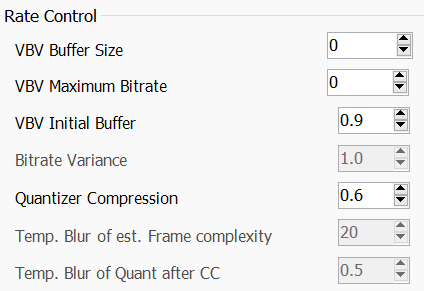

*Figure: x264 rate-control options, shown to illustrate the different targets; the interface version is not a recommendation of current settings. Source: VCB-Studio, “Video Encoder Fundamentals.”*

### CRF Is Not a “Fixed Quality Percentage”

CRF values can only be compared relative to one another within the same encoder, similar versions, and similar settings:

- CRF numbers from different encoders are not equivalent;
- The same CRF produces different bitrates and sizes on different sources;
- Changing the preset, tune, resolution, bit depth, or amount of denoising also changes the result;
- CQ/ICQ scales in hardware encoders cannot be read with x264/x265 CRF experience.

The reliable approach is to test representative clips: dark gradients, fast motion, fine lines, particles, glows, camera shake, noise, complex transitions, and heavy text.

### Presets, Tunes, and Psychovisual Optimization

- **Preset** mainly decides how much search and decision-making the encoder will spend. Slower presets usually compress more efficiently, with diminishing returns;
- **Tune** changes the trade-offs the encoder makes for a particular type of content;
- A tune called `animation` is not automatically right for all Japanese anime, let alone for MAD with heavy compositing, particles, and live-action footage;
- Choose parameters by testing on the work itself. Do not treat one fansub group's, one era's, or one software version's settings table as a universal standard.

### VBV and Peak Limits

The VBV model constrains bitstream peaks with a maximum bitrate and buffer size, matching network or hardware decoding capacity. Set too tight, it forces a visible quality drop in complex shots; with no limit at all, the stream may exceed what the target device or platform can handle at any instant.

### Software and Hardware Encoding

- Software encoders usually offer more thorough search and finer parameter control, and suit high-quality final output;
- GPU and media-engine hardware encoders are faster, and suit previews, proxies, recording, and time-critical tasks;
- Hardware encoding quality changes markedly between generations, so “CPU versus GPU” alone does not settle the question;
- In the end, compare the actual picture, speed, and compatibility under the same delivery constraints.

## 8. Intermediate Files, Proxies, and Masters

### Intermediate Formats

For editing and compositing intermediates, prioritize:

- Frame-accurate access;
- Light decoding load;
- Enough bit depth and chroma precision;
- Alpha support;
- Stability across repeated processing;
- Compatibility with your editing software.

Common choices include ProRes, DNxHR, CineForm, FFV1, uncompressed video, and PNG/TIFF/EXR image sequences. The right one depends on your software, operating system, alpha and HDR needs, and storage budget.

### Proxies

Proxies reduce decoding and storage load while editing; they are not the final master. A proxy workflow must ensure that:

1. Each proxy maps to exactly one original file;
2. Duration, timecode, frame rate, and audio sync match;
3. Key shots are spot-checked after relinking;
4. The final export really references the originals, not the proxies;
5. Speed changes, nested sequences, and VFR sources are verified separately.

### Masters and Delivery Versions

Distinguish at least the following:

| Type | Purpose | Priorities |
| --- | --- | --- |
| Project master | Later remakes, subtitled versions, platform transcodes | High bit depth, minimal generation loss, complete audio |
| Contest submission | Meets the current edition's rules | Strictly follows the required container, codec, duration, and size |
| Platform upload | Upload to Bilibili and other platforms | Platform-compatible, with headroom for the platform's own transcode |
| Review copy | Team proofing and quick transfer | Small, with a version number or watermark |

Give masters, delivery versions, and project files clear version numbers rather than names like “final2_really_final.”

## 9. Containers and Tracks

### Common Containers

| Container | Main characteristics | Things to watch |
| --- | --- | --- |
| MP4 | Widely supported by platforms and devices | Limited support for subtitles, attachments, and some audio formats |
| MKV | Rich support for tracks, subtitles, chapters, and attachments | Some editors and platforms do not accept it directly |
| MOV | Common in production, works with many intermediate codecs | Compatibility depends on the codec inside |
| WebM | Usually paired with VP9/AV1 and Opus | May not be accepted by contests or traditional editing setups |

When muxing, check default and forced tracks, languages, track names, chapters, subtitle fonts, delays, color tags, and rotation metadata.

### Limits of Cutting Without Re-Encoding

Most long-GOP video can only be cut losslessly near a keyframe that allows random access. Even when a tool reports success, the cut point may move earlier, the first segment may show corruption, or timestamps may be rewritten. When you need frame-accurate cuts, do them on an editing timeline or in an intermediate format.

### A Safe Remux Example

```bash
ffmpeg -i input.mkv -map 0 -c copy output.mkv
```

This command only illustrates the idea of copying all tracks into a new container. In a real project, still check attachments, chapters, track labels, timestamps, and compatibility with the target container.

## 10. Audio Fundamentals

### Sample Rate, Bit Depth, and Channels

- **Sample rate** is how many audio samples are taken per second; 48 kHz is common in video production;
- **Bit depth** affects the quantization precision of PCM samples;
- **Channel count** is not the same as channel layout; six channels can be arranged in different ways;
- **PCM** is uncompressed sampling, FLAC is lossless compression, and AAC, Opus, and similar formats are usually lossy.

Keep a single sample rate within a project where possible to avoid repeated resampling. Importing 44.1 kHz music does not mean you must first convert it to a separate lossy 48 kHz file; the editor can process it internally at high precision and output everything at one rate.

### Loudness, Peaks, and True Peak

- Sample peak only checks whether individual samples reach the ceiling;
- **True peak** estimates peaks that can appear between samples when the waveform is reconstructed;
- **LUFS** describes perceived loudness over a given time scale;
- A limiter is not a substitute for mixing, and a single loudness number cannot tell you whether a work sounds right.

Platforms may normalize loudness on playback, but their rules change. Keep an unclipped master and check the actual uploaded result.

### Sync and Delay

Audio/video sync problems can come from:

- VFR timestamps;
- Mixing 23.976 with 24, or 29.97 with 30;
- Encoder delay and container compensation;
- Tracks with different start times;
- Resampling or speed changes;
- Cuts made without re-encoding that fall on audio frame boundaries.

Checking only the start is not enough to catch drift; check the middle and the end as well.

## 11. Identifying Image Defects

The goal is not to “throw a filter at every problem,” but to tell apart characteristics of how the source was produced, problems with the release medium, processing mistakes, and encoding loss. Every fix needs a clearly identified target and a frame-by-frame comparison with the unprocessed version.

### Banding

Smooth gradients break into visible steps. Causes include low bit depth, heavy quantization, a wrong range conversion, or excessive denoising. Debanding usually needs dither or protective noise; too much processing erases shading lines and texture that were really there.

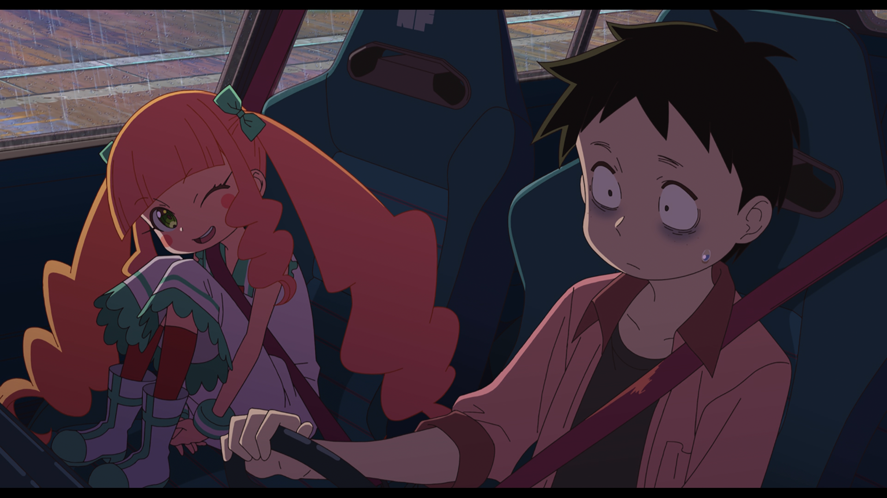

*Figure: Banding. Source: VCB-Studio, “Recognizing Defects.”*

### Aliasing

Diagonal lines, curves, or scaled detail show stair-steps and unstable flicker. The cause may be the original drawing, upscaling from a low resolution, wrong field handling, or the scaling algorithm. Anti-aliasing is not the same as blurring the whole picture.


*Figure: Aliasing. Source: VCB-Studio, “Recognizing Defects.”*

### Ringing and Haloing

Ripples, bright edges, or dark edges appear around high-contrast boundaries, often from over-sharpening, scaling, or compression. When treating it, distinguish it from outlines, glow effects, and other edges that belong to the original artwork.


*Figure: Ringing. Source: VCB-Studio, “Recognizing Defects.”*

### Noise and Grain

Noise can come from the sensor, film, scanning, compression, or the production process, and grain may be a texture the creators deliberately kept. Denoising changes how hard a source is to encode, but too much of it melts lines, removes texture, and turns motion into smears.

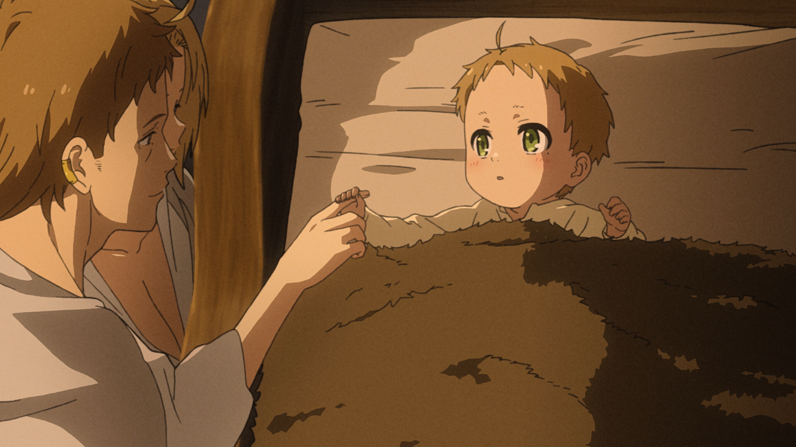

*Figure: Noise. Source: VCB-Studio, “Recognizing Defects.”*

### Blocking and Mosquito Noise (DCT Ringing)

When bitrate is too low or quantization too strong, block boundaries become visible, and shimmering specks, ragged edges, and DCT ringing can appear around text and lines. Post-processing can soften these artifacts but cannot restore detail that has been lost.

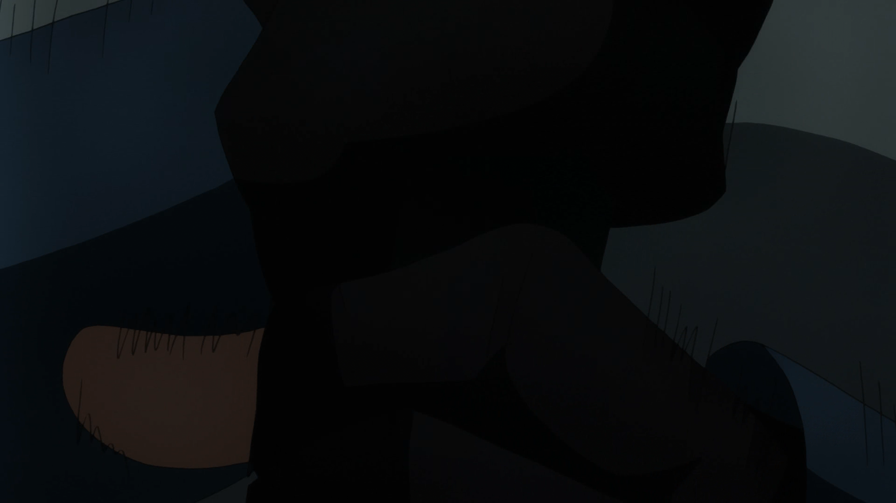


*Figure: Blocking and DCT ringing. Source: VCB-Studio, “Recognizing Defects.”*

### Out-of-Range Luma and Clipping

Misreading the range can turn valid highlights or shadows into pure white or black. The figures below compare luma overflow with the result after restoring the correct range.

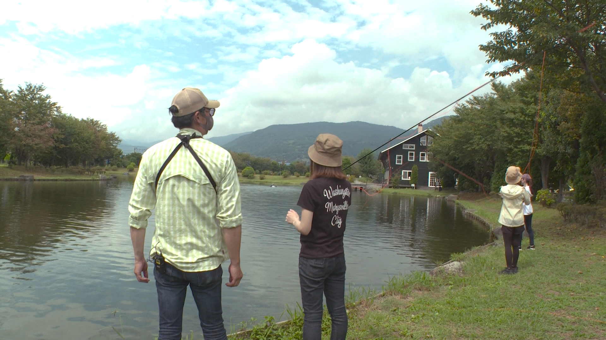

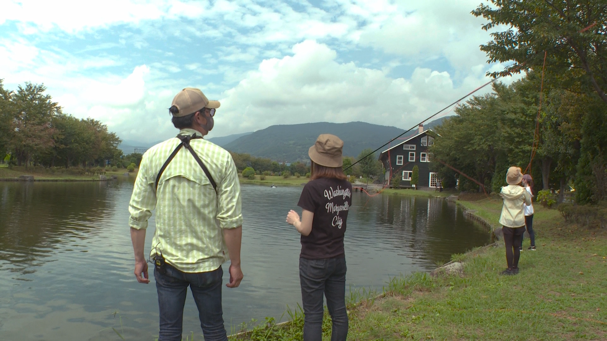

*Figure: Luma overflow and its correction. Source: VCB-Studio, “Recognizing Defects.”*

If the data has already been clipped, changing the tag afterward cannot recover the detail. Before fixing anything, determine whether it is a display interpretation error or whether the pixel values themselves have been cut off.

### Combing, Scaling Artifacts, and Duplicate Fields

- **Combing**: two fields from different moments are displayed together as one frame;
- **Striping from interlaced scaling**: footage was scaled with a progressive algorithm before its field structure was dealt with;
- **Duplicate fields**: both fields of a frame are actually the same, which is easily confused with ordinary aliasing.

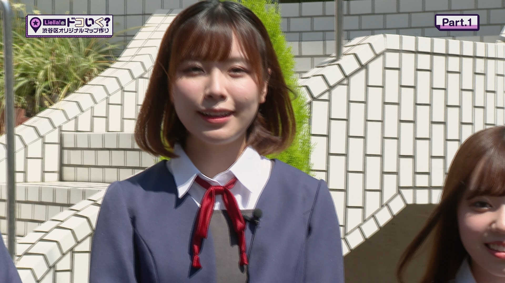


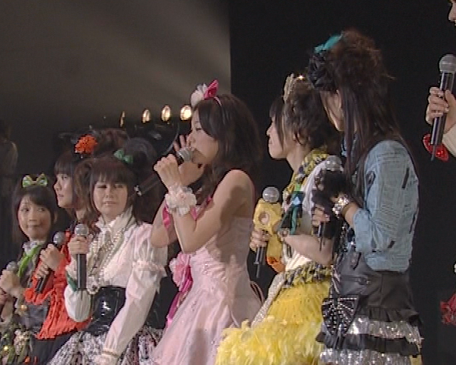

*Figure: Interlacing-related defects. Source: VCB-Studio, “Recognizing Defects.”*

### Blending and Ghosting

Abnormal blending of adjacent frames leaves translucent trails at moving edges. It can come from incorrect standards conversion, deinterlacing, or temporal processing. Some regular patterns can be partly undone; irregular blending is usually very hard to reverse completely.


*Figure: Blending. Source: VCB-Studio, “Recognizing Defects.”*

### Chroma Banding, Chroma Aliasing, and Chroma Shift

The precision of the chroma planes, the downsampling algorithm, and errors in sample location produce defects distinct from those in the luma plane:


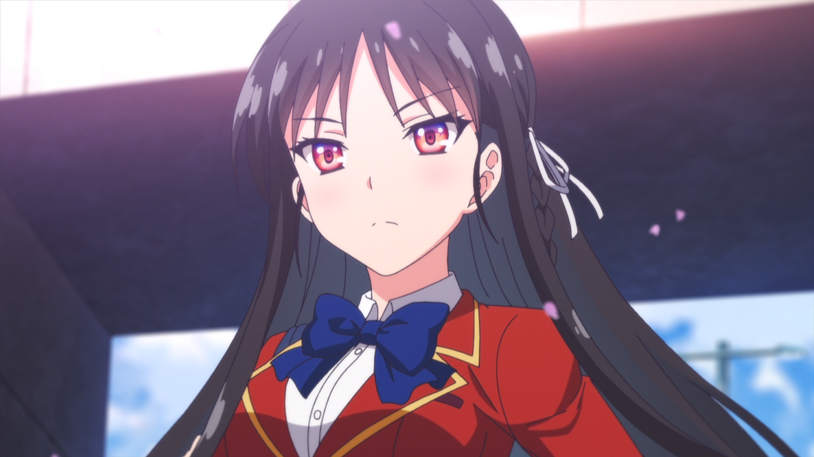

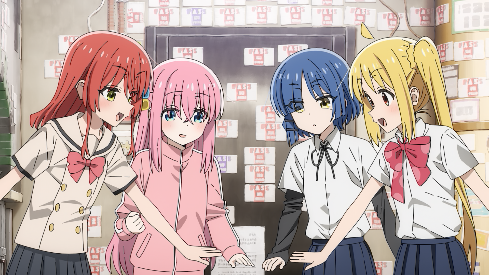

*Figure: Chroma banding, chroma aliasing, and chroma shift. Source: VCB-Studio, “Recognizing Defects.”*

Chroma shift is usually a one-directional offset of the chroma planes relative to luma. It is different from a deliberate visual effect that offsets the RGB channels:

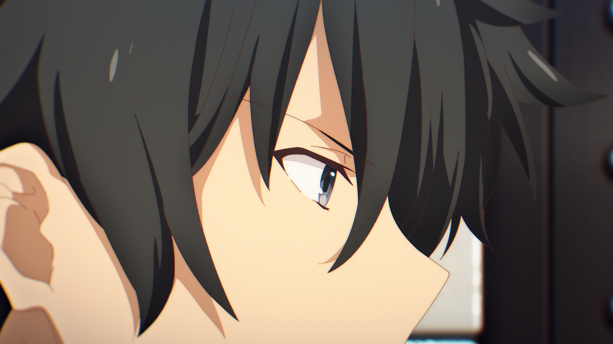

*Figure: An RGB shift effect, shown for contrast with abnormal chroma shift. Source: VCB-Studio, “Recognizing Defects.”*

### Chroma Bleeding

Highly saturated colors spread into their surroundings, so color boundaries extend well past the luma edges. This is different from a directional chroma shift.

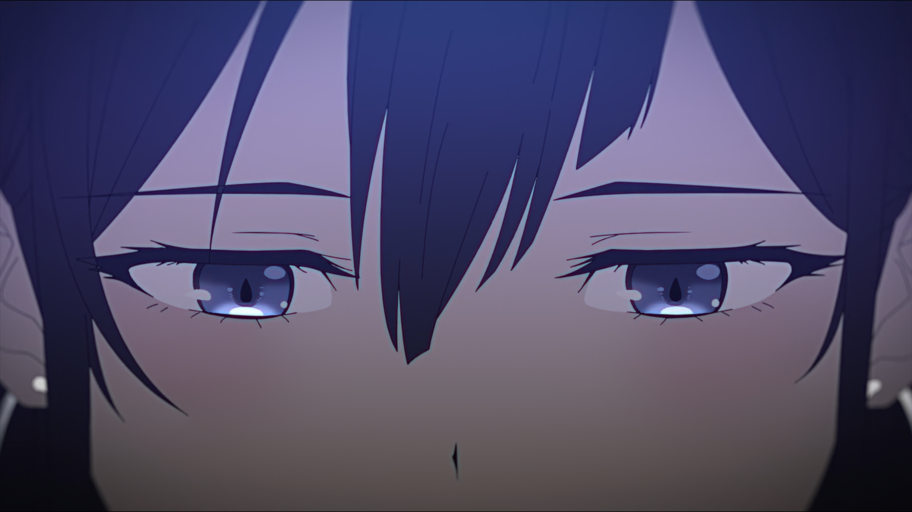

*Figure: Chroma bleeding. Source: VCB-Studio, “Recognizing Defects.”*

### Rainbowing and Dot Crawl

Early analog composite video or poor transfers can let high-frequency luma leak into chroma, producing red-blue rainbow patterns or crawling dot patterns.

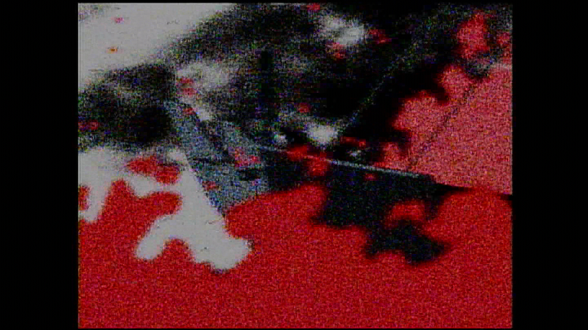

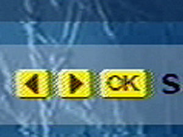

*Figure: Rainbowing and dot crawl. Source: VCB-Studio, “Recognizing Defects.”*

## 12. A Suggested MAD·AMV Production Workflow

### 1. Register Source Media

Record the source, release version, episode, time range, container, codec, resolution, frame rate, color information, and audio tracks. BD, streaming, WEBRip, PVs, game captures, and your own graphics should not be lumped together by file extension.

### 2. Diagnose

Build a parameter record with MediaInfo/ffprobe, then check frame by frame:

- Whether the footage is truly interlaced, falsely flagged, or telecined;
- Whether it is CFR or VFR;
- Whether there are range, matrix, or chroma-location errors;
- Whether defects come from production, the release, or a platform's recompression;
- Whether a higher-quality source exists.

### 3. Preprocess

Fix only problems you have confirmed. Keep:

- The original files;
- Processing scripts and their versions;
- Key parameters;
- Before-and-after comparison frames;
- A record of any cropping, speed changes, deinterlacing, and color conversions applied.

### 4. Proxies and Editing

Standardize proxy naming, timecode, and audio sync. Set the timeline frame rate according to the work's main rhythm and the delivery rules; do not let the first imported clip decide it and never check again.

### 5. Compositing and Intermediate Output

Do heavy grading, glows, particles, motion blur, text, and keying in a high-bit-depth environment where possible. When moving between applications, prefer low-loss intermediate formats or image sequences, and confirm the alpha type and color space.

### 6. Master Output

The master should keep enough bit depth and chroma precision. Do not use a low-bitrate long-GOP delivery encode as your only archive. Keep a lossless version of the audio, and record the project sample rate, channel layout, and loudness processing.

### 7. Delivery Encoding and Muxing

Generate the contest version, the Bilibili upload, and other platform versions separately from the master. Do not use a file downloaded after one platform's transcode as the master for another.

### 8. Check After Upload

Platforms transcode again. After uploading, spot-check:

- The opening, the ending, and random points in between;
- Dark gradients, strong flashes, fast motion, fine lines, subtitles, and particles;
- Audio sync and channels;
- Which quality levels the platform actually offers;
- The thumbnail, title, description, subtitles, and work statement.

## 13. Delivery Checklist

### File and Picture

- [ ] The file reads completely, and its total duration meets the contest limit;
- [ ] The first frame, last frame, black frames, and end card are not cut off by mistake;
- [ ] Resolution, SAR, DAR, and rotation metadata are correct;
- [ ] The exact frame rate, CFR/VFR, time base, and timestamps are as expected;
- [ ] Progressive/interlaced structure, field order, telecine, and duplicate frames have been confirmed;
- [ ] Pixel format, bit depth, chroma subsampling, and alpha are correct;
- [ ] Primaries, transfer, matrix, and range tags match the actual pixels;
- [ ] HDR/SDR output meets the target, with no fake conversion by relabeling only;
- [ ] Shadows, highlights, gradients, fine lines, fast motion, and complex effects have been checked;
- [ ] No new banding, aliasing, ringing, blocking, ghosting, or interpolation warping has been introduced.

### Audio

- [ ] Sample rate, codec, channel count, and channel layout are correct;
- [ ] No pops, clipping, swapped channels, or unexpected silence;
- [ ] Audio sync has been checked at the start, middle, and end;
- [ ] Loudness and true peak meet the team's or contest's requirements;
- [ ] Licensing information for music, dialogue, and sound effects has been recorded.

### Container and Versions

- [ ] The container and codec combination is accepted by the target platform or organizer;
- [ ] Default tracks, languages, titles, chapters, subtitles, and font attachments are correct;
- [ ] File name, version number, and submitter information follow the rules;
- [ ] The master, submission version, and upload version can be matched to each other unambiguously;
- [ ] A checksum such as SHA-256 has been generated and saved;
- [ ] A final check has been done on another device or the target player;
- [ ] The online version has been checked again after the platform finishes transcoding.

## 14. Common Misconceptions

| Claim | More accurate understanding |
| --- | --- |
| “MP4 looks better than MKV” | Both are containers; picture quality depends mainly on the video inside and how it was processed |
| “10-bit makes 8-bit sharper” | It cannot restore source detail, but it reduces quantization error in later processing and re-encoding |
| “Higher bitrate is always better” | Past the point of transparency, more bitrate adds little; source quality and encoding efficiency matter just as much |
| “CRF 18 means the same thing in every encoder” | CRF scales are only comparable within the same implementation and similar settings |
| “Use the animation tune for all anime” | A tune is a specific trade-off; test on the actual work |
| “All duplicate frames should be removed” | Animation timing, telecine, VFR, and erroneous duplicates are different problems |
| “Interpolating to 60 fps makes it smoother” | Interpolation creates new images and can break the original rhythm and introduce artifacts |
| “Relabeling it Rec.709 fixes it” | Tags, pixel conversion, and range clipping must be kept apart |
| “Denoising lowers the bitrate, so quality improves” | Denoising can also remove original texture, grain, and fine lines |
| “If the file plays, it is ready to deliver” | Sync, color, frame structure, complex shots, and platform recompression still need checking |

## References and Image Licensing

### Main References

- [VCB-Studio public guides](https://guides.vcb-s.com/)
- [Chapter 1: Understanding Video from Scratch](https://guides.vcb-s.com/basic-guide-01/)
- [Chapter 3: Tools and the Encoding Workflow](https://guides.vcb-s.com/basic-guide-03/)
- [Chapter 4: Recognizing Defects](https://guides.vcb-s.com/basic-guide-04/)
- [Chapter 7: Video Encoder Fundamentals](https://guides.vcb-s.com/basic-guide-07/)
- [Chapter 10: Basic 30 fps Processing](https://guides.vcb-s.com/basic-guide-10/)
- [VCB-Studio Guides source repository](https://github.com/vcb-s/guides)
- [FFmpeg Formats Documentation](https://ffmpeg.org/ffmpeg-formats.html)
- [ffprobe Documentation](https://ffmpeg.org/ffprobe.html)
- [MediaInfo](https://mediaarea.net/MediaInfo)

### Localization and Licensing

The VCB-Studio tutorial images on this page have been copied into this site's repository so that they do not break if the original links change; each image is credited below it. The public VCB-Studio guides are licensed under [Creative Commons Attribution-ShareAlike 4.0 International (CC BY-SA 4.0)](https://creativecommons.org/licenses/by-sa/4.0/). The images and the parts of this page adapted from their content are attributed and shared under the same license.

This page is not a mirror of the VCB-Studio guides and does not replace them. To study BDRip production, VapourSynth, x264/x265 parameters, and targeted repairs in depth, read the original chapters and follow their latest versions.

## Related Pages

- [Source Media and Project Management](/en/tools/footage): sources, intake records, and project archiving;
- [Contest and Submission Guidelines](/en/mad/contest-rules): common delivery specs and submission packages;
- [Tools Overview](/en/tools/): where encoding fits in the overall workflow.
